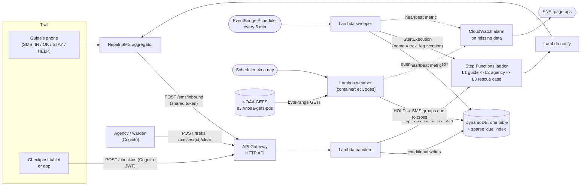
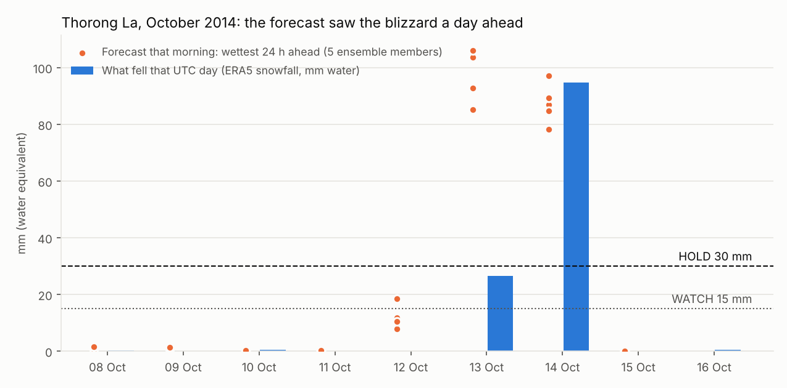
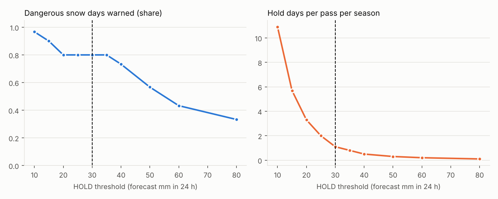
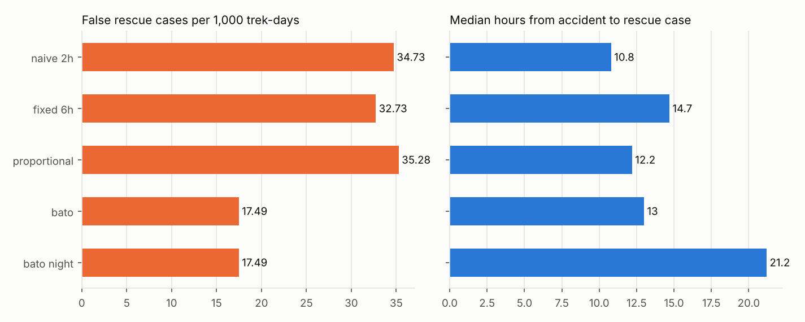

# Bato (बाटो): knowing when a trekking group hasn't arrived, and when a pass is about to close

Bato watches trekking groups on Nepal's high routes and notices when one **doesn't arrive**. A guide texts `IN Manang` from a feature phone; Bato knows the group's plan, works out when they should reach the next village, and if they don't, climbs a ladder: an SMS to the guide, then the agency, then a rescue case. Every six hours it also reads NOAA's forecast for six high passes and puts a pass on **storm hold** when heavy snow is coming, telling every group due to cross it. Only a person on the ground can lift a hold.

It runs on AWS serverless, costs **about $15 a month in AWS charges** at peak season, and the expensive part is SMS, which I treat as the main thing to design for.

```text
13 Oct 11:20  guide SMS        'IN yak karka' -> BATO AC14OCT001: Yak Kharka noted. Next: Thorong Phedi by 14 Oct 17:27.
13 Oct 11:45  weather poller   GEFS 2014-10-13 00Z: Thorong La 103.9 mm in 24 h -> HOLD (2 SMS)
13 Oct 11:45  SMS -> guide     BATO AC14OCT001: STORM HOLD Thorong La. Forecast 104 mm in 24 h, heavy snow. Do not cross from 13 Oct until cleared. Reply STAY if you wait.
14 Oct 09:05  guide SMS        'IN thorung phedi' -> ... Next: Muktinath by 15 Oct 14:54. STORM HOLD on Thorong La: do not cross.
14 Oct 09:30  guide SMS        'STAY 2' -> BATO AC14OCT001: Plan moved. Next: Muktinath by 17 Oct 14:54.
16 Oct 07:00  warden (API)     lifts the hold after looking at the trail
17 Oct 15:00  ladder -> guide  BATO AC14OCT001: no arrival at Muktinath yet. Sabai thik? Reply OK, IN <place>, STAY or HELP.
17 Oct 17:00  ladder -> agency BATO AC14OCT001: group of 4 overdue at Muktinath, last check-in Thorong Phedi 14 Oct 09:05 ...
17 Oct 22:10  trekker SMS      'IN muktinath' -> ... and FOUND to everyone who was told
```
*(Abridged output of `make demo`: a made-up group replayed through the real engine in October 2014. The forecast numbers are the real GEFS forecasts for Thorong La from those mornings.)*

## The problem

In October 2014 the remains of Cyclone Hudhud reached the Annapurna region as a blizzard. Trekkers, guides and porters were caught in the open, many of them on the way to or over Thorong La (5,416 m). At least 43 people died. The storm was forecast. What didn't exist was anything that turned a forecast into "don't cross tomorrow" for the people at Manang and Thorong Phedi, or that knew which groups were on the pass and hadn't come down.

Ten years later, if a group goes missing between two villages, it is usually noticed when someone expected to hear from them and didn't: often family abroad, days later. Since April 2023 foreign trekkers in Nepal's national parks and conservation areas must walk with a licensed guide, and nearly every guide has a phone. That makes a simple, cheap system possible: **the guide's phone is the sensor.**

The architecture problem has an unusual shape:

| Property | Value | Consequence |
|---|---|---|
| The main event | Something that **doesn't** happen (a check-in that never arrives) | The system needs timers for tens of thousands of groups, and must never lose one. |
| Connectivity | Good in big villages, patchy higher up, none at some camps | A missing check-in usually means "no signal", not "in trouble". The alert policy is the product. |
| Users | Guides on feature phones, agencies in Kathmandu, foreign trekkers, families abroad | SMS first; an app or a checkpost tablet is a bonus. |
| Weather | Big storms are rare but forecastable 1-2 days ahead | Forecast data has to become an instruction for the specific groups who will cross. |
| Cost | Runs on permit-fee economics in a low-income country | Pennies per trek. SMS dominates, so the alert policy is also the cost policy. |
| Failure | If the watcher stops, nobody notices, because silence is normal | The system has to alarm on its *own* silence. |

## Architecture



Four ideas carry the design:

1. **A sweeper over a sparse index, not a timer per group.** Every open trek carries its deadline in a sparse GSI keyed by hour. Every five minutes one Lambda asks "whose deadline has passed?": 25 small queries, however many groups are walking. No per-trek schedules to create, update and delete on every check-in, and a sweeper that was down for an hour catches up by itself ([ADR-002](docs/ALTERNATIVES.md#adr-002-timers-a-sweeper-over-a-sparse-index)).
2. **The escalation is a state machine with a name.** Each overdue starts one Step Functions execution named after the trek, the leg and the trek's version, so two sweepers racing start one ladder, not two. A check-in stops it; before every rung the notify step re-reads the trek anyway ([ADR-003](docs/ALTERNATIVES.md#adr-003-the-escalation-ladder-step-functions-standard)).
3. **No deadline where there's no signal.** A group sleeping at a tented camp with no network can't check in, so expecting them to guarantees a false alarm. The watch skips to the next place they can check in from, and patchy places get four extra hours ([ADR-004](docs/ALTERNATIVES.md#adr-004-no-deadline-where-theres-no-signal)).
4. **Machines issue storm holds; people lift them.** The forecast clearing doesn't mean the trail is safe: fresh snow and avalanche slopes stay. A hold ends only when a ranger or lodge committee member in the Cognito `pass-wardens` group clears it ([ADR-006](docs/ALTERNATIVES.md#adr-006-machines-issue-holds-people-lift-them)).

Full diagram, request flows, data model and DR: **[docs/ARCHITECTURE.md](docs/ARCHITECTURE.md)**.

## Results

### 1. Would the storm hold have worked? Ten years of real forecasts

I scored the hold rule (wettest 24 hours in the next 48 hours at the pass's grid cell, HOLD at 30 mm, WATCH at 15 mm) against every morning's real GEFS forecast in the spring and autumn trekking seasons of 2010-2019, and used ERA5 reanalysis snowfall as the yardstick for what actually fell ([details](docs/STORM_HOLDS.md), [data](data/README.md)).



**Hudhud, October 2014.** The 12 October run put Thorong La on WATCH (18.5 mm). The 13 October run, readable before noon Nepal time, forecast **104 mm** in 24 hours, and **all five ensemble members** were above the HOLD line. ERA5 has **95 mm** falling on 14 October, the day most people were caught. A HOLD SMS on the morning of the 13th reaches groups at Manang and Thorong Phedi before they would have crossed. The same run put Larkya La (Manaslu) on HOLD too.

| Across 10 years, 4 distinct grid cells, 6,040 forecast days | At HOLD = 30 mm |
|---|---:|
| Days with 20+ mm of snow at a pass (≈20 cm+) | 30 |
| ...that had a HOLD the morning before or of | **24 (80%)** |
| ...that had at least a WATCH | 27 (90%) |
| Hold days per pass per season | **1.1** |
| Thorong La: hits / misses / false holds | 7 / 3 / 9 |
| Larkya La: false holds per season | 2.2 (a wetter cell; it needs its own threshold) |



The threshold sits on a plateau: anything from 25 to 35 mm catches the same 24 days, and the number of holds falls from 2.0 to 0.8 a season. I chose the low end, because a missed storm costs lives and a false hold costs a day. Three of the six misses had a WATCH; the clean miss was a late-May storm at Thorong La in 2016 that the forecast didn't see.

### 2. How long should it wait before calling a group overdue?

This is the real design question, and you can't test it on real trekkers. So I [simulated a 1,500-group autumn season](bato/simulate.py) **through the real engine**: the same check-in code, sweeper and ladder, on a 15-minute clock. Only the trekkers are made up: their pace, their unplanned rest days, 18 accidents, and when their SMS actually gets through from each village ([every assumption](docs/GRACE_POLICY.md)). At L2 the simulated agency phones the lodge, as real agencies do.



| Policy | False L1 per 1,000 trek-days | False rescue cases | Median hours, accident to rescue case |
|---|---:|---:|---:|
| No system: family raises the alarm 2 days after the planned end | 0 | 0 | **159** |
| Deadline at every stop, 2 h grace | 257 | 572 | 10.8 |
| Deadline at every stop, 6 h grace | 143 | 539 | 14.7 |
| Deadline at every stop, grace = max(3 h, half the walk) | 201 | 581 | 12.2 |
| **Bato:** that, +4 h at patchy stops, no deadline where there's no signal | 152 | **288** | **13.0** |
| Bato + rescue cases due at night wait for first light (tried, rejected) | 152 | 288 | 21.2 |

What I'd tell an interviewer about this table:

- **The grace period wasn't the lever. Signal was.** Tripling the grace from 2 to 6 hours barely moved false rescue cases (572 to 539), because most false alarms come from places a check-in physically can't leave. Not expecting one there halved them, for about 2 hours of detection.
- **That trade has a tail.** Bato's p90 time to a rescue case is 37 hours against 16-19 for the others: an accident on the way to a no-signal camp isn't noticed until the group misses the *next* village. That's the price of the decision, and the reason the trail table's connectivity column is the first thing to verify in the field.
- **My "obvious" fix did nothing.** I expected that holding night-time rescue cases until first light would cut false ones, since nobody flies in the dark. It cut zero (the groups' messages arrive after first light anyway) and delayed real ones by 8 hours. I kept it in the table and out of the code.
- **The absolute numbers depend on my assumptions;** 288 false rescue cases in 16,468 trek-days is still about one per 57 trek-days, and most are groups asleep at a patchy lodge whose phone didn't answer. What carries over is the ranking, and the finding that a lodge phone directory is worth more than any timer tweak.

### 3. Cost

| | Quiet month (2,000 treks) | Peak month (30,000 treks) |
|---|---:|---:|
| API Gateway, Lambda, DynamoDB, Step Functions, CloudWatch | 2.15 | 14.64 |
| SMS to Nepali numbers | 131.75 | 1,976.28 |
| SMS to foreign numbers | 79.28 | 1,189.25 |
| **Total (USD)** | **213.19** | **3,180.17** |
| **Per trek** | **0.11** | **0.11** |

**SMS is 99.5% of the bill**, so the cost decisions are SMS decisions: the first rung goes to the guide only (a foreign number costs 8x), replies are plain ASCII (a Devanagari SMS segment holds 70 characters, not 160), informational messages stop at a daily budget while anything about a group in trouble never does. And the alert policy is the biggest lever: the naive 2-hour policy would make the peak month $4,477. Itemised in [docs/COST.md](docs/COST.md).

## Engineering documents

| Document | What's in it |
|---|---|
| [Architecture](docs/ARCHITECTURE.md) | Diagram, the five flows, data model, scaling, single-region DR with RTO/RPO |
| [Alternatives considered](docs/ALTERNATIVES.md) | 10 decision records: EventBridge Scheduler vs DynamoDB TTL vs a sweeper; Step Functions vs SQS delays; GEFS vs Open-Meteo vs ECMWF; and why this problem |
| [What breaks](docs/FAILURE_MODES.md) | 20 failure modes with detection and response, starting with "the watcher stops watching" |
| [Storm holds](docs/STORM_HOLDS.md) | The rule, the hindcast in full, the misses, what the data can't tell you |
| [Grace policy](docs/GRACE_POLICY.md) | Every assumption in the season simulation and how sensitive the answer is |
| [Cost](docs/COST.md) | Itemised, with the cost decisions in the code |
| [Security and privacy](docs/SECURITY_AND_PRIVACY.md) | Who can do what; spoofed check-ins; passport-grade data I chose not to hold |
| [Runbook](docs/RUNBOOK.md) | Before the season, when the pager goes, when a storm is coming |
| [Challenges and bugs](docs/CHALLENGES_AND_BUGS.md) | 16 real problems hit while building this, with the evidence and the fix |

## How it maps to the AWS Well-Architected pillars

| Pillar | In this project |
|---|---|
| Operational excellence | All IaC (SAM); the state machine is generated from code and CI fails if it drifts; alarms on the sweeper's and the poller's *silence*, not only on errors; runbook |
| Security | Cognito for agencies and wardens, group check for lifting holds; shared-token check on the SMS webhook with constant-time compare; no phone numbers or SMS text in logs; data deleted 30 days after a trek by TTL; least-privilege IAM per function |
| Reliability | Conditional writes with a version number on every change; idempotent check-ins keyed by message id; deterministic execution names; retries with jitter and a catch-all that pages a human if SMS can't go; DLQ on every schedule; PITR |
| Performance efficiency | Five-minute sweeps over a sparse index; ~3 MB of byte-range reads per forecast instead of whole GRIB files; Graviton |
| Cost optimisation | ~$15/month of AWS at peak; SMS budget breaker for non-critical messages; guide-only first rung; GSM-7 text; on-demand everything |
| Sustainability | Nothing runs between sweeps; weather is read four times a day, matching the forecast cycle |

## Run it

**With Python 3.12+:**

```bash
make setup && source .venv/bin/activate
make demo        # October 2014 on the Annapurna Circuit, replayed through the engine
make hindcast    # storm-hold rule vs 10 years of real forecasts (artifacts/reports/hindcast.json)
make simulate    # the alert-policy table and chart (~6 minutes)
make cost        # cost model
make live        # today's real forecast at the six passes, straight from NOAA's bucket
make test        # 57 tests, including every Lambda handler against mocked AWS (moto)
```

**On AWS:** [infra/README.md](infra/README.md). One stack in ap-south-1 (Mumbai, the closest region to Nepal). I haven't left it deployed: it would cost little, but a safety service people might rely on shouldn't exist without the agencies and an SMS contract behind it.

## Repository layout

```text
bato/
  trails.py       the trail network: stops, sections, walking hours, names as people type them
  itinerary.py    a trek's plan, acclimatisation warnings, deadlines, check-in/OK/STAY rules, pace learning
  engine.py       registration, check-ins, the sweeper, the ladder, storm holds (ports: store, effects, SMS)
  store.py        DynamoDB single-table store and an in-memory twin with the same conditional semantics
  sms.py          inbound command parser, outbound messages, budget breaker, aggregator client
  escalation.py   the Step Functions definition, generated from code
  forecast.py     GEFS from S3: .idx parsing, byte ranges, decode once, point lookup
  holds.py        the hold rule and scoring
  hindcast.py     the rule vs 10 years of reforecasts and ERA5
  simulate.py     a season of made-up trekkers through the real engine
  cost.py         the cost model
  aws/handlers.py Lambda entry points
infra/            SAM template, state machine JSON, weather Dockerfile, deploy guide
scripts/          pull the weather extracts from the public buckets
data/             trail network, passes, processed weather extracts
tests/            57 tests
docs/             the engineering documents above
```

## Data and credits

Forecasts: NOAA Global Ensemble Forecast System (GEFS) v12 reforecast and operational GEFS, via the NOAA Open Data Dissemination program on AWS. Reanalysis: ERA5 (Hersbach et al., 2020; ECMWF / Copernicus Climate Change Service), via the NSF NCAR Research Data Archive copy on AWS (ds633.0). Acclimatisation guidance: Wilderness Medical Society clinical practice guidelines (2019 update). Trail data: hand-built from published itineraries ([data/README.md](data/README.md)).

## License

MIT.
