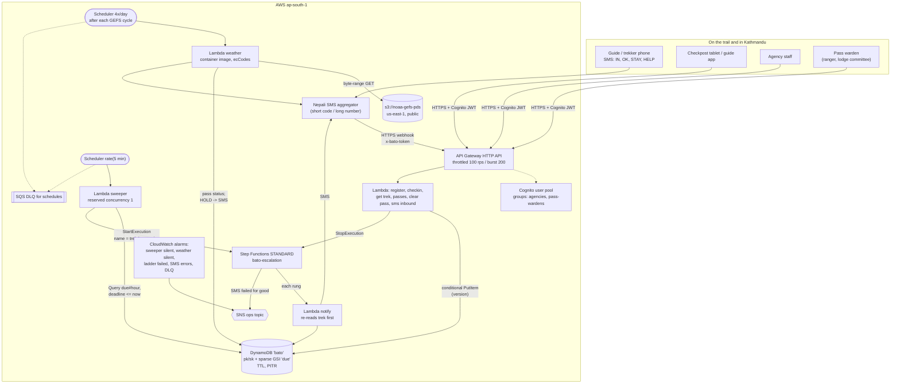

# Architecture

## The picture



## The five flows

### 1. Registering a trek

The agency (or the checkpost, when it issues the permit) posts the group: itinerary as a list of nights, start date, guide phone, agency duty phone, optional leader phone and emergency contact. `itinerary.plan` turns nights into **moves** (rest days aren't moves), finds the quickest path for each through the trail graph, marks which moves cross a pass and whether the destination can be checked in from, and returns **acclimatisation warnings** against the Wilderness Medical Society advice (above 3,000 m, don't raise sleeping elevation by more than 500 m a day; rest every 3-4 days). Warnings don't block registration: the guide decides, but the agency now sees "Night 5 at Dingboche sleeps 550 m higher than the night before" in writing.

Writes: the trek item (conditional on not existing), one `PHONE#` item per phone for SMS lookup, one `PASS#` item per pass crossing.

### 2. A check-in

From SMS (`IN Thorung Phedi`), the app or a checkpost tablet. Each carries an id (the aggregator's message id, or a client UUID) and, for app check-ins, the time it was *made*, which may be hours before it was *delivered*.

1. Resolve the place name: aliases, one-typo tolerance, and the group's own itinerary wins ties ("Phedi" means a different place on two of my routes).
2. `PutItem EVENT#<id>` with `attribute_not_exists`: a duplicate SMS or a retried request stops here.
3. Load the trek, apply `itinerary.check_in`, save with `version = :expected`. On a conflict, reload and re-apply (up to five times).
4. If the trek was overdue: stop the execution and SMS "FOUND" to everyone who was told.

`check_in` is **order-safe**: a check-in from a place behind the group's last known position (a message that sat in a phone for two days) is recorded but doesn't move the group back. Arriving a day late (or early) re-anchors the rest of the plan to the real date. Each same-day arrival nudges the group's **learned pace** (walked hours / book hours, clamped to 0.9-1.8x), so a slow group isn't alarmed every afternoon.

### 3. Overdue: sweeper and ladder

```mermaid
sequenceDiagram
    participant S as Sweeper (every 5 min)
    participant D as DynamoDB
    participant F as Step Functions
    participant N as Notify Lambda
    participant G as Guide
    participant A as Agency
    S->>D: Query GSI due, due_pk = DUE#2014-10-17T09, due_sk <= now (x25 hours)
    D-->>S: trek AC14OCT001
    S->>D: PutItem status=OVERDUE, version 7 -> 8 (if version = 7)
    S->>F: StartExecution name=AC14OCT001-m6-v7
    F->>N: L1
    N->>D: still OVERDUE with this execution?
    N->>G: no arrival at Muktinath yet. Sabai thik?
    F->>F: Wait 2 h
    F->>N: L2
    N->>A: group overdue, last check-in Thorong Phedi; call the lodges
    G-->>D: IN muktinath (via SMS)
    D-->>F: StopExecution (from the check-in handler)
```

The deadline for a move is `planned departure + walk x pace + grace`, where departure is 07:00 (04:00 on a pass day) and **grace = max(3 h, half the walk) + 4 h if the destination's signal is patchy**. Destinations with no signal get no deadline; the watch moves to the next place the group can check in from.

The ladder: **L1** at the deadline to the guide only; **L2** two hours later to the agency duty phone and the trek leader's own phone; **L3** six hours after the deadline, a rescue case to the agency and an SMS to the emergency contact. If the move crosses a pass that is on storm hold, L2 and L3 come at one and three hours. `HELP` from any phone on the trek skips straight to the agency.

Replies that stop the ladder: a check-in, `OK` (safe, not there yet: look again in 4 hours, or at 09:00 if that lands in the night), `STAY` (not moving today: the rest of the plan slides a day).

### 4. Weather and storm holds

Four times a day, half an hour after each GEFS cycle's 0.25° files are complete, the weather Lambda reads the control forecast from NOAA's public bucket. It fetches each 6-hour file's `.idx` index, then only the APCP message by HTTP range (about 250 KB each, 12 of them), decodes once with ecCodes and picks out the six grid cells. The rule takes the wettest 24 hours in the next 48 at each pass: **HOLD at 30 mm, WATCH at 15 mm**, both chosen from the hindcast.

When a pass's level *rises*, every group planning to cross it in the next two days (the `PASS#` items) gets an SMS: critical for HOLD, budgeted for WATCH. When the forecast clears, the hold **stays** and is marked `awaiting_clearance`; a warden lifts it through the API.

The function is a container image only because ecCodes is a native library; it's the one thing in the stack that isn't a 256 KB zip.

### 5. Watching the watcher

The sweeper and the poller each emit a heartbeat metric through CloudWatch embedded metric format (a log line, no API call). Alarms with `TreatMissingData: breaching` fire when the heartbeat stops: 15 minutes for the sweeper, 13 hours for the weather. Silence is the normal state of a trekking group, so the only way to notice that the system itself has stopped is to alarm on the system's silence. A failed ladder (SMS down after retries) ends in an SNS publish to the ops topic and an `ExecutionsFailed` alarm, so a person always learns that a group is overdue even if no SMS could be sent.

## Data model

One table, on-demand.

| pk | sk | What | Written by |
|---|---|---|---|
| `TREK#<id>` | `META` | Plan, position, status, target move, deadline, escalation name, level, pace, version, notified phones; `due_pk`/`due_sk` only while OPEN | every change, conditional on version |
| `TREK#<id>` | `EVENT#<msg id>` | One check-in: place, made-at, received-at, channel | check-in, `attribute_not_exists` |
| `PHONE#<e164>` | `TREK#<id>` | Which treks a phone belongs to | registration |
| `PASS#<pass>` | `DAY#<date>#TREK#<id>` | Who plans to cross which pass on which day | registration, then old/new diff on every plan change |
| `PASSSTATUS` | `<pass>` | Level, forecast mm, cycle, awaiting clearance, cleared by | weather poller, warden |
| `SMSBUDGET` | `<date>` | Informational SMS sent today (atomic counter) | SMS gateway |

**GSI `due`** (keys only): `due_pk = DUE#<UTC hour of the deadline>`, `due_sk = deadline`. Sparse: an item is in the index only while the trek is OPEN, so the sweeper never reads a finished or overdue trek. Hour buckets keep each partition small (at 30,000 treks a month, a few hundred deadlines per hour) and make the catch-up window a simple loop over the last 24 hours.

**TTL** deletes treks, events, phone and crossing items 30 days after the last planned day (events after 120 days). **PITR** is on.

## How it scales

| Load | What happens |
|---|---|
| Peak October, 30,000 treks, ~8,000 walking on a given day | ~8,000 check-ins a day, ~25 sweeper queries every 5 minutes, a few hundred ladders a day. Every service is far below its default quotas. |
| A storm hold on Thorong La | One query on `PASS#thorong-la` for the next two days; a few hundred SMS. The SMS aggregator's throughput is the limit, not AWS. |
| Everyone checks in at once after a storm | Check-ins are independent items with conditional writes; on-demand DynamoDB absorbs it. The aggregator again is the bottleneck. |
| Scheduler quota | Not relevant: there are no per-trek schedules (ADR-002). |

This is a small-throughput system with a large correctness surface. The design effort went into "never lose a timer" and "never alarm for nothing", not into throughput.

## Disaster recovery

Single region (ap-south-1), on purpose (ADR-009).

| Failure | RTO | RPO | How |
|---|---|---|---|
| A Lambda or the state machine misbehaves | minutes | 0 | Alarms; roll back the stack |
| Sweeper down < 24 h | 0 when it returns | 0 | It reads the last 24 hourly buckets on every run, so missed deadlines are found on the next run |
| Data corruption (a bad deploy rewrites treks) | ~1 h | seconds | PITR restore to a new table, switch `BATO_TABLE` |
| Region down | ~2-4 h | up to PITR/backup age | Deploy the same template to ap-southeast-1, restore the latest backup; agencies fall back to phoning guides (the runbook's paper process) |

Why not multi-region: the expensive part of a missed trekker is hours, and the realistic regional outage is shorter than a ladder's L3. A warm standby would double the moving parts that can disagree about whether a group is overdue (two sweepers, two ladders, two "FOUND"s). The day this carries thousands of groups through a winter, I'd revisit it with DynamoDB global tables and only one active sweeper.

## Going live

1. Confirm the connectivity column in `data/trails.json` with agencies and lodge owners (it decides where deadlines exist).
2. Sign an SMS aggregator contract with a short code or long number; set `SmsMode=aggregator` and the SSM parameters.
3. Onboard agencies and wardens in Cognito (admin-created users, MFA available).
4. Run a season in shadow mode: ladders send to a test number only; compare against what agencies actually did.
5. Calibrate per-pass thresholds (Larkya La needs its own) and the grace policy from shadow-mode data, not the simulation.
